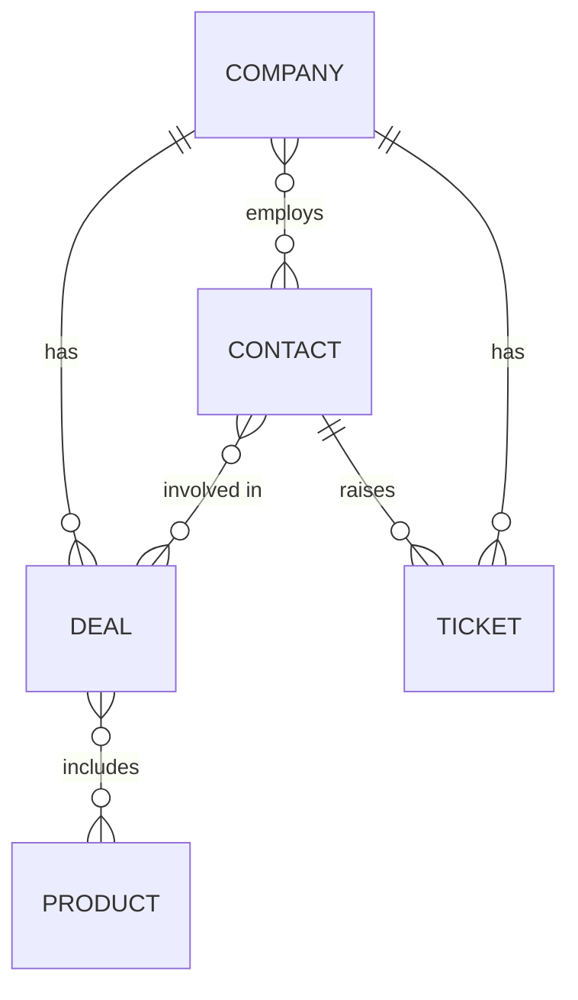
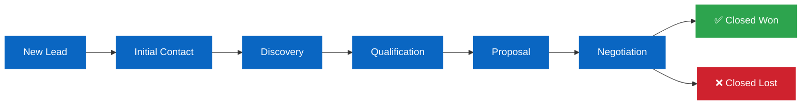

# 🚀 HubSpot CRM Implementation

**From scattered spreadsheets to a governed, tested and documented CRM.**

An end-to-end HubSpot CRM administration. It shows how to take a business from messy spreadsheets to a CRM that is organised, tested and easy to maintain, and it covers every stage of a client project, from discovery to handover and ongoing operations.

## 📋 Overview

| | |
|---|---|
| 🧩 **Platform** | HubSpot CRM (Free baseline) |
| 🏢 **Scenario** | Growing B2B SaaS company with sales, marketing, customer success and support teams |
| 📄 **Format** | Client brief, delivery runbook, templates and checklists in one document |
| ⏱️ **Duration modelled** | 6 to 8 weeks, in 10 phases |
| 👤 **Author** | Muhammad Hasaif Akram |

## 🎯 The problem

The fictional client starts with these issues. The playbook is designed to solve each one.

| # | Problem | Business impact |
|---|---|---|
| 1 | 🗂️ Customer and prospect data is scattered across spreadsheets and disconnected tools | No single view of a customer |
| 2 | 👥 Duplicate contacts and company records | Unreliable reporting |
| 3 | 📉 Sales reps use inconsistent stages and rarely record next steps | Pipeline cannot be trusted or forecast |
| 4 | 🔍 Lead source and qualification data is incomplete | Marketing performance is unclear |
| 5 | ⏰ Follow-ups are missed and not visible to managers | Lost opportunities |
| 6 | 📊 Managers cannot see pipeline health, conversion or loss reasons | Decisions made without data |
| 7 | 🎫 Support requests are categorised inconsistently | Slow, uneven support |
| 8 | 🔄 Renewal dates and customer health are not maintained | Renewals at risk |
| 9 | 📚 No property dictionary, data-entry standard or change log | The CRM cannot be maintained |
| 10 | 🧑‍🏫 Users have no guide for working in the CRM | Low adoption |

## ✅ The solution

| Problem | How the playbook solves it |
|---|---|
| Scattered data | Controlled migration: source inventory, cleaning, field mapping, test import and reconciliation |
| Duplicates | Duplicate management procedure: backup, identify, review ambiguous pairs, approved merge, duplicate log |
| Inconsistent sales process | Stage governance: each stage has an owner, entry and exit criteria, required information and a stale-deal threshold |
| Incomplete lead data | A property dictionary with controlled values, plus data-entry standards |
| Missed follow-ups | Saved views and an agreed process for recording next steps |
| No visibility | A KPI dictionary with calculation rules, and role-based dashboards built only after definitions are approved |
| Messy support requests | A ticket process with categories, priorities and status handling |
| Renewals | A renewal process with a defined renewal date and a monthly data review |
| Unmaintainable CRM | Configuration log, change-request process and admin SOPs |
| Low adoption | User guides, role-based training and a handover pack |

## ⚙️ How it works

The project follows one path. Nothing is configured before the process is confirmed and approved.

### 🗓️ The 10 delivery phases

| Phase | Effort | Main output |
|---|---|---|
| 1. Initiation and governance | 2 days | Project charter, scope, stakeholder register |
| 2. Discovery and audit | 3 to 4 days | Discovery notes, current-state audit, requirements |
| 3. Process and architecture | 4 to 5 days | As-is and to-be processes, CRM data model |
| 4. Data governance | 3 to 4 days | Property dictionary, standards, data quality rules |
| 5. Build and configuration | 5 to 7 days | Configured CRM and configuration log |
| 6. Migration | 3 to 5 days | Cleaned import files, mapping, validation report |
| 7. Automation and integrations | 3 to 5 days | Automation design, exception handling |
| 8. Reporting | 2 to 4 days | KPI dictionary, report and dashboard specification |
| 9. QA and UAT | 3 to 4 days | Test plan, defect log, sign-off |
| 10. Training and handover | 2 to 3 days | SOPs, training, handover and backlog |

### 📏 Working rules

- 🧪 Use a test record before touching live or imported data.
- 🚫 Never import a spreadsheet until its columns are mapped, cleaned, backed up and approved.
- 🔎 Verify every feature in the actual HubSpot subscription instead of trusting a tutorial.
- 📝 Record every important change: what, why, who approved it, when, and how it was tested.
- 🔒 Use fictional or sample data only. Never expose real customer information.

<b>🏷️ Status labels and the evidence each one needs</b>

 

| Status | Evidence required |
|---|---|
| Not started | None |
| In progress | Working notes, draft or screenshots |
| Implemented | Portal screenshot and configuration record |
| Tested | Test case result and evidence |
| Approved | Approval date and approver |
| Deferred / upgrade required | Reason, workaround and future recommendation |

## 🏗️ CRM design highlights

### Data model

Standard HubSpot objects, linked by associations instead of copied data. The diagram is illustrative, and the exact association behaviour is confirmed in the portal.

### Sales process

Each stage is a business control, with an owner, entry and exit criteria and a stale-deal threshold.

### Data quality rules

Six monitored rules keep the CRM trustworthy, for example:

- ✅ Every active lead has an owner.
- ✅ Lead source uses approved values.
- ✅ Open deals have an amount and expected close date.
- ✅ Closed-lost deals have a loss reason.

### KPIs and dashboards

Eight KPIs, each with a written definition, a calculation rule, an owner and a review cadence: new leads, open pipeline value, deals won, win rate, average deal size, unassigned leads, open tickets and renewals due.

| Dashboard | Audience |
|---|---|
| 🏁 Executive Overview | Founder and leadership |
| 💼 Sales Operations | Sales manager |
| 📣 Marketing Operations | Marketing lead |
| 🤝 Customer Success | Customer success lead |
| 🎧 Support Operations | Support lead |

<b>📚 What is inside: the 18 playbook sections</b>

 

1. Client project brief
2. Project charter and statement of work
3. Discovery and current-state audit
4. Requirements specification and traceability
5. Business process design
6. CRM architecture and data model
7. Property dictionary and data governance
8. HubSpot configuration runbook
9. Data migration and import procedure
10. Automation and integration design
11. Reporting and KPI specification
12. User access, privacy and security
13. Testing strategy, QA and UAT
14. Training and standard operating procedures
15. Final handover and project closure
16. Ongoing CRM operations after go-live
17. Reusable client templates
18. Glossary and administrator reference

## ⚠️ Scope and limitations

- Custom software, paid HubSpot features beyond the subscription, enterprise-only functionality and large-scale historical migration are out of scope unless separately approved.
- Product menus and feature limits change, so check them against the official HubSpot Knowledge Base before implementation.

## 👤 Author

**Muhammad Hasaif Akram**, AI Automation Engineer

